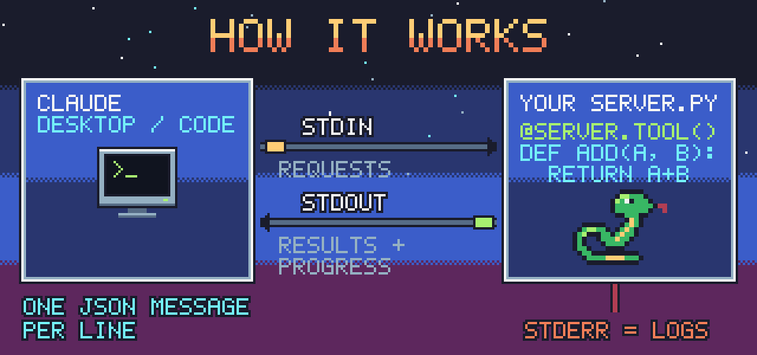
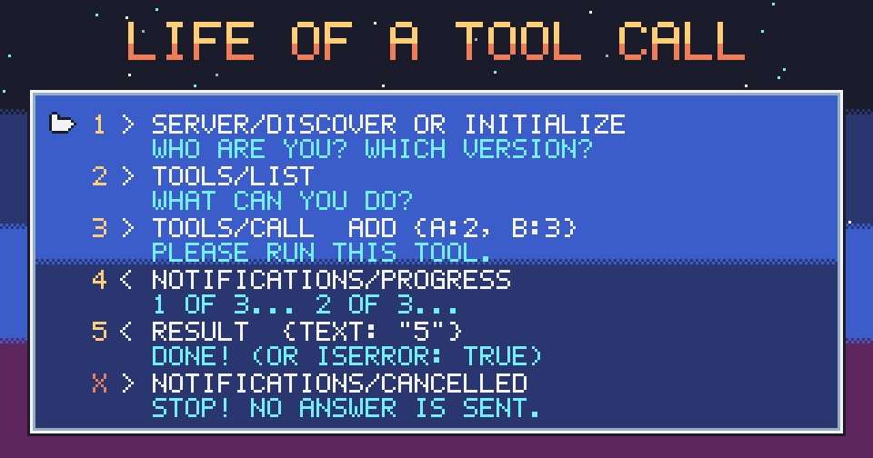

<p align="center">
  
</p>

<p align="center">
  <a href="https://www.python.org/"></a>
  
  <a href="https://modelcontextprotocol.io/specification/2026-07-28"></a>
  <a href="LICENSE"></a>
</p>

<p align="center">
  <b>MimimalMCP: a <a href="https://modelcontextprotocol.io">Model Context Protocol</a> server in one Python file.</b><br>
  Copy <code>mimimalmcp.py</code> into your project, decorate a function, and Claude can call it.
</p>

---

## Contents

- [Why does this exist?](#why-does-this-exist)
- [Features](#features)
- [Quick start](#quick-start)
- [How it works](#how-it-works)
- [Writing tools](#writing-tools)
- [Progress and cancellation](#progress-and-cancellation)
- [Errors](#errors)
- [Connect to Claude Code](#connect-to-claude-code)
- [Connect to Claude Desktop](#connect-to-claude-desktop)
- [Under the hood: the protocol on the wire](#under-the-hood-the-protocol-on-the-wire)
- [Protocol support](#protocol-support)
- [Examples](#examples)
- [Tests](#tests)
- [Limits](#limits-compared-with-the-official-sdk)
- [Troubleshooting](#troubleshooting)
- [Possible future work](#possible-future-work)
- [License](#license)

## Why does this exist?

The official [MCP Python SDK](https://github.com/modelcontextprotocol/python-sdk)
is complete and well maintained. It also brings dependencies and a lot of
code, which makes it hard to see what MCP actually is: a few JSON messages
going back and forth over a pipe.

`mimimalmcp.py` is the opposite trade-off:

- **One file.** Copy it next to your script. There is nothing to `pip install`
  and no virtual environment to set up.
- **Readable.** It is about 400 lines, and roughly a quarter of them are
  comments. You can read the whole server in one sitting and know exactly what
  goes over the wire.
- **Enough for real use.** It covers tools, progress, cancellation, clean error
  reporting, and both the current stateless protocol and the classic
  handshake.

Use it to **learn MCP**, or to give Claude a few tools in a **small project**.
When you need resources, prompts, HTTP or authorization, move to the official
SDK. Your tool functions will port over easily.

## Features

| | |
| --- | --- |
| 🐍 **Plain functions as tools** | `@server.tool()` on a normal `def`. The docstring becomes the description. |
| 🧩 **Schema from type hints** | `int`, `str`, `list[str]`, `Optional`, `Literal` and `Annotated` all become JSON Schema. |
| ⏳ **Progress** | `ctx.progress(3, total=10, message="...")` sends `notifications/progress`. |
| 🛑 **Cancellation** | `ctx.cancelled` and `ctx.check_cancelled()` react when the user presses Stop. |
| 🧯 **Errors never crash the server** | Exceptions become `isError` results that the model can read. |
| 🧵 **Concurrent calls** | Every tool call runs in its own thread, so a slow tool doesn't block the others. |
| 🔇 **Protected stdout** | A stray `print()` goes to stderr and cannot corrupt the protocol. |
| 🪟 **Cross-platform** | Binary UTF-8 streams, with no newline or code-page surprises on Windows. |
| 📡 **Two protocol eras** | It speaks stateless `2026-07-28` and the `initialize` handshake (`2025-11-25` and older). |

## Quick start

```python
from mimimalmcp import Server
server = Server("demo")
@server.tool()
def add(a: int, b: int) -> int: return a + b
server.run()
```

1. Save the code above as `demo.py` next to `mimimalmcp.py`.
2. Run `claude mcp add demo -- python /full/path/to/demo.py`.
3. Ask Claude: *"use the add tool to add 2 and 3"*.

You need Python 3.9 or newer, on Windows, macOS or Linux.

## How it works

<p align="center">
  
</p>

1. Claude (Desktop or Code) **starts your script** as a subprocess.
2. It writes **JSON-RPC requests to your script's stdin**, one JSON object per
   line.
3. Your script writes **responses and notifications to stdout**, also one per
   line.
4. Anything meant for humans goes to **stderr**: logs, tracebacks and stray
   prints. Claude Desktop saves it in its MCP log files.

That's the whole transport. Everything else is deciding which JSON to send
back.

## Writing tools

```python
from typing import Annotated, Literal, Optional
from mimimalmcp import Context, Server, ToolError

server = Server("my-tools", version="1.0.0",
                instructions="Optional hints for the model about these tools.")

@server.tool()
def resize(path: str,
           width: Annotated[int, "Width in pixels"],
           mode: Literal["fit", "fill"] = "fit",
           quality: Optional[int] = None) -> dict:
    """Resize an image."""                 # the docstring is the description
    if width <= 0:
        raise ToolError("width must be positive")   # clean error for the model
    return {"path": path, "width": width}  # dict -> JSON text + structuredContent

if __name__ == "__main__":
    server.run()
```

### Type hints → JSON Schema

| Python | JSON Schema |
| --- | --- |
| `str`, `int`, `float`, `bool` | `{"type": "string"}`, `"integer"`, `"number"`, `"boolean"` |
| `list[str]` | `{"type": "array", "items": {"type": "string"}}` |
| `dict[str, int]` | `{"type": "object", "additionalProperties": {"type": "integer"}}` |
| `Optional[int]` or `int \| None` | `{"anyOf": [{"type": "integer"}, {"type": "null"}]}` |
| `Literal["a", "b"]` | `{"enum": ["a", "b"]}` |
| `Annotated[int, "Width in pixels"]` | `{"type": "integer", "description": "Width in pixels"}` |
| no hint, `Any`, other classes | `{}` (anything goes) |
| `x: int = 5` | `{"type": "integer", "default": 5}`, and `x` is not required |

If the generated schema isn't what you want, write it yourself. The function
then receives the arguments as keyword arguments:

```python
@server.tool(schema={"type": "object",
                     "properties": {"query": {"type": "string", "minLength": 3}},
                     "required": ["query"]})
def search(query):
    ...
```

### Options of `@server.tool()`

| Option | Default | Meaning |
| --- | --- | --- |
| `name` | the function name | 1–128 characters from `A-Z a-z 0-9 _ . -` |
| `title` | none | a human-friendly name shown by some clients |
| `description` | the docstring | what the model reads to decide when to call the tool |
| `schema` | built from type hints | the JSON Schema of the arguments |
| `annotations` | none | hints such as `{"readOnlyHint": True}` or `{"destructiveHint": True}` |

`@server.tool` without parentheses works too.

### Return values

| Your tool returns | Claude receives |
| --- | --- |
| `str` | one text block |
| `dict` | the JSON as text **and** as `structuredContent` |
| `list`, `int`, `float`, `bool` | the JSON as text |
| `None` | empty content |

## Progress and cancellation

Add a parameter annotated as `Context`. The server fills it in, and it does not
appear in the schema.

```python
import time
from mimimalmcp import Context

@server.tool()
def slow_count(to: int, ctx: Context) -> str:
    """Count slowly."""
    for i in range(1, to + 1):
        if ctx.cancelled:                       # the user pressed Stop / Esc
            return f"Stopped at {i}."
        ctx.progress(i, total=to, message=f"counted {i} of {to}")
        time.sleep(0.5)
    return f"Counted to {to}."
```

| `Context` member | What it does |
| --- | --- |
| `ctx.progress(value, total=None, message=None)` | Sends `notifications/progress`. It is ignored when the client did not ask for progress, and values that don't grow are dropped, as the spec requires. |
| `ctx.cancelled` | `True` once the client sent `notifications/cancelled` for this call. |
| `ctx.check_cancelled()` | Raises `Cancelled` if the call was cancelled. It is handy inside deep loops. |
| `ctx.log(message)` | Writes a line to stderr, tagged with the tool name. |
| `ctx.request_id`, `ctx.tool_name` | Tell you which call this is. |

After a call is cancelled, the server sends **nothing more** for it: no
progress and no result. That is exactly what the MCP spec asks for.

## Errors

There are two kinds of error, and MCP treats them differently.

| What went wrong | What Claude sees |
| --- | --- |
| Your tool raised `ToolError("message")` | a result with `isError: true` and your message |
| Your tool raised any other exception | `isError: true` with `TypeName: message`; the traceback goes to stderr |
| Missing or unknown arguments | `isError: true` with Python's `TypeError` message |
| Unknown tool name | a JSON-RPC error `-32602` |
| Invalid JSON, a batch, or an unknown method | a JSON-RPC error `-32700`, `-32600` or `-32601` |

Tool failures come back as normal results, so the model can read the message
and try again. The server keeps running in every case.

## Connect to Claude Code

```sh
claude mcp add demo -- python /full/path/to/demo.py
claude mcp list                     # should say: demo ... ✓ Connected
```

Arguments after the script path are passed to it, for example:

```sh
claude mcp add files -- python /path/examples/files.py /path/to/my/notes
```

On Windows, use the full path to `python.exe`, not `pythonw.exe`, which has no
stdin/stdout.

## Connect to Claude Desktop

Open **Settings → Developer → Edit Config**. That opens
`claude_desktop_config.json`, which lives in:

| OS | Folder |
| --- | --- |
| macOS | `~/Library/Application Support/Claude/` |
| Windows | `%APPDATA%\Claude\` |

Add your server and restart Claude Desktop:

```json
{
  "mcpServers": {
    "demo": {
      "command": "python",
      "args": ["/full/path/to/demo.py"]
    }
  }
}
```

On Windows, escape the backslashes in JSON (`"C:\\Users\\me\\demo.py"`) or use
forward slashes (`"C:/Users/me/demo.py"`). If `python` is not on the `PATH`
that Claude Desktop sees, put the full path to `python.exe` in `command`.

## Under the hood: the protocol on the wire

<p align="center">
  
</p>

These are real messages from the examples. Lines starting with `→` go
to the server; lines starting with `←` come back.

**Classic handshake** (`2025-11-25` and earlier):

```text
→ {"jsonrpc":"2.0","id":1,"method":"initialize","params":{"protocolVersion":"2025-11-25","capabilities":{},"clientInfo":{"name":"me","version":"1"}}}
← {"jsonrpc":"2.0","id":1,"result":{"protocolVersion":"2025-11-25","capabilities":{"tools":{"listChanged":false}},"serverInfo":{"name":"hello","version":"0.1.0"}}}
→ {"jsonrpc":"2.0","method":"notifications/initialized"}
→ {"jsonrpc":"2.0","id":2,"method":"tools/list"}
← {"jsonrpc":"2.0","id":2,"result":{"tools":[{"name":"greet","description":"Greet someone by name.","inputSchema":{"type":"object","properties":{"name":{"type":"string"},"excited":{"type":"boolean","default":false}},"required":["name"]}}]}}
→ {"jsonrpc":"2.0","id":3,"method":"tools/call","params":{"name":"greet","arguments":{"name":"Ada"}}}
← {"jsonrpc":"2.0","id":3,"result":{"content":[{"type":"text","text":"Hello, Ada."}]}}
```

**Stateless** (`2026-07-28`, used by recent Claude Code). There is no
handshake: every request carries its protocol version and the client
capabilities in `_meta`, and every result says `resultType`.

```text
→ {"jsonrpc":"2.0","id":1,"method":"server/discover","params":{"_meta":{"io.modelcontextprotocol/protocolVersion":"2026-07-28","io.modelcontextprotocol/clientCapabilities":{}}}}
← {"jsonrpc":"2.0","id":1,"result":{"supportedVersions":["2026-07-28"],"capabilities":{"tools":{}},"ttlMs":0,"cacheScope":"public","resultType":"complete","_meta":{"io.modelcontextprotocol/serverInfo":{"name":"hello","version":"0.1.0"}}}}
```

**Progress**: the client asks for it by sending a `progressToken`.

```text
→ {"jsonrpc":"2.0","id":5,"method":"tools/call","params":{"name":"slow_count","arguments":{"to":2},"_meta":{"progressToken":"t1"}}}
← {"jsonrpc":"2.0","method":"notifications/progress","params":{"progressToken":"t1","progress":1,"total":2,"message":"counted 1 of 2"}}
← {"jsonrpc":"2.0","method":"notifications/progress","params":{"progressToken":"t1","progress":2,"total":2,"message":"counted 2 of 2"}}
← {"jsonrpc":"2.0","id":5,"result":{"content":[{"type":"text","text":"Counted to 2."}]}}
```

**Cancellation**: the client sends a notification, and the server answers
nothing for that call.

```text
→ {"jsonrpc":"2.0","method":"notifications/cancelled","params":{"requestId":5,"reason":"user pressed Stop"}}
```

You can try it yourself: run `python examples/hello.py` in a terminal and
paste the `→` lines (without the arrow).

## Protocol support

| | |
| --- | --- |
| Transport | stdio: newline-delimited JSON-RPC 2.0, UTF-8, binary streams |
| Protocol versions | `2026-07-28` (stateless, via `server/discover` and `_meta`); `2025-11-25`, `2025-06-18`, `2025-03-26` and `2024-11-05` (via `initialize`) |
| Requests | `server/discover`, `initialize`, `ping`, `tools/list`, `tools/call` |
| Notifications | sends `notifications/progress`; receives `notifications/cancelled` and `notifications/initialized` |

Two clients were tested against the server:

| Client | Protocol it used |
| --- | --- |
| Claude Code 2.1.296 | `2026-07-28`: it probes `server/discover`, then sends stateless requests |
| official Python SDK client 2.3.0 | `initialize` handshake, `2025-11-25` |

## Examples

| File | Shows |
| --- | --- |
| [`examples/hello.py`](examples/hello.py) | the smallest server: one tool, one argument with a default |
| [`examples/progress.py`](examples/progress.py) | progress notifications, and stopping early when cancelled |
| [`examples/files.py`](examples/files.py) | read-only file tools limited to one folder, `ToolError`, and tool annotations |

The examples add the parent folder to `sys.path` because they live in a
subfolder. In your own project, `mimimalmcp.py` simply sits next to your
script.

## Tests

```sh
python -m unittest discover -s tests -v
```

The tests use `unittest` only. They start real server processes and talk to
them in JSON-RPC, the same way Claude does. They cover:

- the handshake and the stateless protocol;
- schema generation;
- errors, unicode, concurrency, progress and cancellation;
- every example.

## Limits (compared with the official SDK)

MimimalMCP stays small on purpose. It does **not** do any of the following:

| Area | Not supported |
| --- | --- |
| Server features | resources, prompts, completions, the `tasks` extension |
| Client features | sampling, elicitation, roots, `input_required` results |
| Transport | Streamable HTTP, SSE, authorization |
| Arguments | validation against the JSON Schema; only Python's own argument check applies |
| Results | images, audio, resource links, `outputSchema` |
| Tools | `async def` tools; changing the tool list after `run()`; pagination |
| Logging | protocol log messages; logs only go to stderr |

## Troubleshooting

<details>
<summary><b>Claude says the server failed to start or disconnected</b></summary>

Run the same command yourself, for example `python /full/path/to/demo.py`. It
should print `[demo] demo 0.1.0 ready with 1 tool(s)` on stderr and then wait.
If you get an `ImportError`, `mimimalmcp.py` is not next to your script.
Claude Desktop keeps each server's stderr in its MCP log files.
</details>

<details>
<summary><b>I piped requests with <code>printf</code> and some answers are missing</b></summary>

The server exits as soon as stdin closes, as the MCP spec recommends, so tool
calls still running at that moment are dropped. Keep stdin open for a moment:

```sh
(printf '%s\n' '{"jsonrpc":"2.0","id":1,"method":"tools/list"}'; sleep 1) | python demo.py
```
</details>

<details>
<summary><b>My tool's <code>print()</code> output doesn't show up in Claude</b></summary>

That's on purpose: stdout belongs to the protocol, so `print()` is redirected
to stderr. Return the text from your tool instead.
</details>

<details>
<summary><b>Accented letters or emoji look broken on Windows</b></summary>

The protocol streams are always UTF-8 and binary, so this should not happen.
If you read files inside a tool, open them with `encoding="utf-8"`.
</details>

## Possible future work

- Resources and prompts
- Streamable HTTP transport
- Image content in tool results
- Optional validation of arguments against the input schema

## License

[MIT](LICENSE). The pixel art in `docs/art/` is generated by
[`docs/art/make_art.py`](docs/art/make_art.py) and uses the
[Sweetie 16](https://lospec.com/palette-list/sweetie-16) palette by GrafxKid (CC0).
